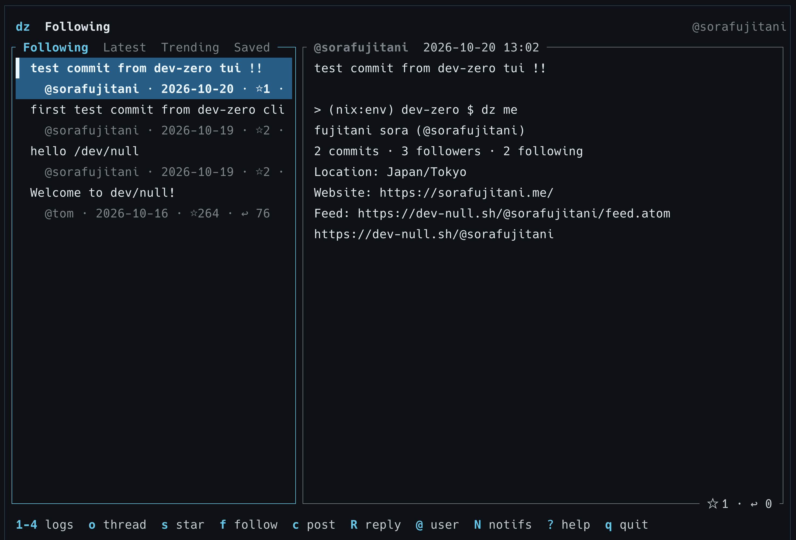
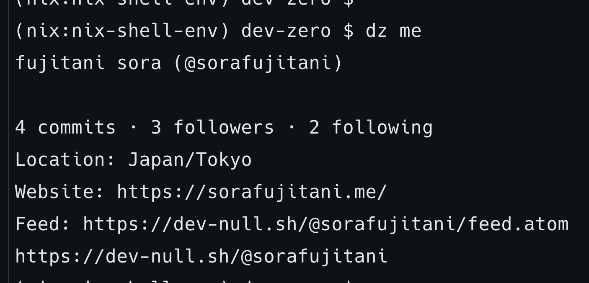

# dev-zero

A small CLI and TUI for [dev-null.sh](https://dev-null.sh).
Written in Rust. The command is `dz`.

Uses the [public API](https://github.com/nunomaduro/dev-null.sh/blob/production/README.md#public-api)
for profiles and commits without an account. After `dz login`, dz signs requests like
the official mobile app and gets everything the web shows you: your Following, Latest
and Trending logs, threads, notifications, saved posts, stars, follows, posting,
quoting and deleting. Posting with a GitHub SSH key through the Action endpoint also
works without signing in.





## Install

Supported platforms: macOS and Linux, both x86-64 and ARM64.
Linux release binaries use musl. Windows is not supported.

### Cargo

Requires Rust 1.88 or newer. Build and install from GitHub:

```sh
cargo install --git https://github.com/sorafujitani/dev-zero --locked
dz --help
```

Or install from a local checkout:

```sh
cargo install --path . --locked
```

The command is `dz`, not `dev-zero`. Ensure Cargo's binary directory
(`~/.cargo/bin` by default) is on PATH. The crate is not published on crates.io;
use `--git` or `--path` rather than `cargo install dev-zero`.
Posting additionally requires OpenSSH 8.2 or newer on PATH.

### Nix

```sh
nix run github:sorafujitani/dev-zero -- --help
nix profile install github:sorafujitani/dev-zero
```

### Homebrew

Requires a published release tag.

```sh
brew tap sorafujitani/dev-zero https://github.com/sorafujitani/dev-zero
brew install sorafujitani/dev-zero/dev-zero
```

The formula builds from the versioned Git tag and requires Rust at build time.

## Build from source

With Nix and flakes enabled, build and run from the repository root:

```sh
nix develop --command cargo build --locked
./target/debug/dz tui nunomaduro
```

This creates a local debug build at `target/debug/dz`; nothing is installed globally.
Run the build command again after changing the source. The binary runs outside the
Nix development shell.

To use `dz` directly in your current shell:

```sh
export PATH="$PWD/target/debug:$PATH"
dz tui nunomaduro
```

Without Nix, install Rust 1.88 or newer, then:

```sh
cargo build --locked
./target/debug/dz tui nunomaduro
```

### Automatic environment with direnv

Install direnv and enable its shell hook in your shell startup file:
`eval "$(direnv hook zsh)"` for zsh, or `eval "$(direnv hook bash)"` for bash.
Then, from the repository root:

```sh
direnv allow
cargo build --locked
dz tui nunomaduro
```

The checked-in `.envrc` loads the Nix development shell and adds `target/debug`
to PATH. Re-enter the directory after enabling the shell hook. Source changes
still require `cargo build --locked`; entering the directory does not build `dz`.
Nix reads Git-tracked files only. For new files needed by the flake, use
`git add -N <path>` to make them visible without staging their contents.

## Usage

```sh
dz                                     # TUI: your Following log, or a user prompt as a guest
dz tui nunomaduro                      # TUI starting on a user
dz user nunomaduro                     # Profile
dz commits nunomaduro                  # One page, up to 20 commits
dz commits nunomaduro --replies        # Replies written by this user
dz commits nunomaduro --cursor '...'   # Next or previous page (cursor or links.next URL)
dz commit <full-commit-id>             # Commit, media URLs, and link preview
dz followers nunomaduro                # Who follows a user; dz following for the reverse
dz --json commits nunomaduro           # Original API response, including cursors

dz login                               # Approve this machine as a device (see below)
dz log                                 # Following; also dz log latest / trending
dz replies <id>                        # A commit's replies, newest first
dz notifications                       # Marks them read, as on the web
dz saved                               # Your saved posts
dz me                                  # Your profile and unread count
dz post 'Hello from dz!'               # Post as the signed-in account
dz post 'Agreed.' --reply <id>         # Reply; --quote <id> quotes instead
dz star <id>  / dz save <id>           # --undo reverses; also follow / mute / block <user>
dz delete <id>                         # Asks first; --yes skips
dz report <id> spam --details '...'    # spam, harassment, unsafe or other
dz logout
dz --help
```

Usernames may start with `@`. Use the full `id`, not `short_hash`, for `dz commit`.
Images and embedded media are shown as links or metadata, not rendered.

JSON output preserves the API envelope and unknown fields. Follow `links.next` or
`meta.next_cursor` until it is `null`; `--cursor` accepts either form. Text output
shows the next and previous cursors when the server provides them.
Errors go to stderr with a nonzero exit status.

The TUI requires an interactive terminal. CLI commands work in pipes.

### Signing in

`dz login` signs in the way dev-null.sh's mobile app does: it creates an ed25519 device
key under `~/.config/dz` (or `$XDG_CONFIG_HOME/dz`, or `$DZ_CONFIG_DIR`) and opens the
approval page. Sign in with GitHub if asked and press **Approve**. The site answers with
a `devnull://auth/callback` link, so dz first registers itself as the handler for that
scheme: on macOS a small `~/Applications/dz Callback.app` (built with `osacompile`,
registered with LaunchServices), on Linux a `dz-callback.desktop` entry via `xdg-mime`.
The browser asks once whether to open "dz Callback"; allow it, and the terminal finishes
the sign-in on its own. If the handler cannot be installed, or nothing arrives, paste the
`devnull://…` address (or just its `code=` value) at the prompt instead.

From then on every request is signed with that key in the `devnull-api` namespace, so
reads return your view (`starred`, `is_saved`, `is_followed`, tombstones in threads) and
the signed-only commands work. Signed requests are limited to 120 a minute per user.
The device appears under Settings → Devices on the web, where it can be revoked; `dz
logout` deletes the local key and session (the handler app stays; delete it by hand if
you like). `--base-url` sessions are kept per origin.

The session needs `ssh-keygen` from OpenSSH 8.2 or newer; Nix and Homebrew provide it.

### Posting

With a session, `dz post` sends through `POST /api/v1/commits`:

```sh
dz post 'Hello from dz!'
dz post 'Thanks for sharing!' --reply <commit-id>
dz post 'Worth a read.' --quote <commit-id>
printf 'A multiline\npost.\n' | dz post --stdin
```

Without a session, or with an explicit `--key`, dz uses the GitHub Action's endpoint
instead. Sign in to dev-null.sh with GitHub first and use an SSH key whose public key is
registered on that GitHub account:

```sh
dz post 'Hello from dz!' --key ~/.ssh/id_ed25519
dz post 'Thanks for sharing!' --reply abc1234 --key ~/.ssh/id_ed25519
printf 'A multiline\npost.\n' | dz post --stdin --key ~/.ssh/id_ed25519
```

To avoid repeating the key path, set `DZ_SSH_KEY` in your shell or `.envrc`:

```sh
export DZ_SSH_KEY="$HOME/.ssh/id_ed25519"
dz post 'Hello from dz!'
```

An explicit `--key` takes precedence over the session. A public key file also works
when its private key is loaded in `ssh-agent`. Encrypted keys may prompt for their
passphrase. The private key stays local; only the signed payload and signature are sent.
The posting account comes from the key, not `DZ_USERNAME`.

Messages must contain 3–4000 characters after trimming. With a session `--reply` and
`--quote` take a commit ID; with `--key`, `--reply` accepts a hash or URL and quoting is
unavailable. Images are not supported.
Posting sends immediately. New posts may be pending moderation and absent from
public reads until approved. The server's confirmation states this.

Posting requires HTTPS, except for local loopback tests. There are no automatic
retries: after a network error, check your profile on the web before trying again
to avoid duplicate posts. The server allows 10 posts per minute.

Posting protocol: https://raw.githubusercontent.com/nunomaduro/dev-null.sh/production/resources/scripts/commit.sh

### Default username

Set `DZ_USERNAME` in your shell or add the export to `.envrc`:

```sh
export DZ_USERNAME=your_username
dz                         # Open the default user's TUI
dz tui                     # Same default
dz user                    # Default user's profile
dz commits --replies       # Default user's replies
dz tui nunomaduro           # An explicit username overrides the environment
```

After editing `.envrc`, run `direnv allow`. Without a default, the TUI prompts for
a username and CLI commands require one. Empty or invalid defaults are rejected.

### TUI

Signed in, the TUI opens on your Following log; as a guest it asks for a username.
The header shows where you are and who you are; the list shows each post's first line
with its author, date, stars and replies; the right pane shows the selected post with
any quoted post. IDs, URLs, media details, and API limits stay out of the way until
you request them. Narrow terminals show one pane at a time: Enter opens a post and
Esc returns. Backspace goes back to the previous list.

#### Browsing

| Key | Action |
| --- | --- |
| `1` / `2` / `3` / `4` | Following / Latest / Trending / Saved (session) |
| `@` | Enter a username |
| `a` | The selected author's commits |
| `o` | Open the thread of the selected post (session) |
| `Backspace` | Back to the previous list |
| `/` | Filter the loaded page by text; Esc clears |
| `j` / `k`, arrows | Move in the focused pane |
| `Tab` / `Enter` | Switch pane / open the selected post |
| `PageUp` / `PageDown` | Scroll detail |
| `g` / `G` | Select first / last commit |
| `n` / `p` | Next / previous page, following the server's cursors |
| `t` | Toggle commits / user's replies |
| `r` | Refresh and return to the first page |
| `s` / `b` | Star / save the selected post (session) |
| `f` | Follow / unfollow the selected author (session) |
| `x` | Delete your own post, after confirmation (session) |
| `c` / `R` / `Q` | New post / reply to / quote the selected post |
| `i` / `u` | Post details / author profile |
| `N` / `m` | Notifications / your profile (session) |
| `?` | Help and remaining API budget |
| `Esc` | Back / close the current panel |
| `q` / `Ctrl-C` | Quit when not editing a draft |

#### Writing

Signed in, drafts post as your account. Without a session, set `DZ_SSH_KEY` or start
with `dz tui --key ~/.ssh/id_ed25519`; the key then determines the posting account.
Press `c` to write a new post, `R` to reply to the selected post, or `Q` to quote it
(session only).

| Key | Action |
| --- | --- |
| Enter | Insert a newline while editing |
| Ctrl+S | Review the draft before sending |
| Enter on the review screen | Send once |
| Esc on the review screen | Return to editing |
| Esc while editing | Cancel; a nonempty draft asks before discarding |

Arrow keys move the cursor. Pasting never sends a post. Drafts stay in memory
when signing or sending fails; check the website before retrying an uncertain
send. They are not saved after the app exits. During SSH passphrase entry, the
TUI briefly returns to the normal terminal, then resumes. A successful send
shows the server's confirmation, including any moderation notice.

Requests run in the background. The current page stays visible on errors.
There is no automatic refresh or retry. The API limits each IP to 60 requests per minute;
wait before retrying a rate-limited request.

For a compatible server or local test, set `DZ_BASE_URL` or pass
`--base-url http://localhost:8080`. Supply only the origin, without `/api/v1`.

## Development

```sh
nix develop
cargo fmt --check
cargo clippy --locked --all-targets -- -D warnings
cargo test --locked
cargo build --locked
python3 -m tests.tui_smoke target/debug/dz
python3 tests/post_smoke.py target/debug/dz
npm test --prefix npm
python3 tests/package_smoke.py target/debug/dz
nix flake check
```

Tests use a local HTTP server, not the live API. The pseudo-terminal test checks
navigation, composition, replies, failed sends, draft recovery, SSH passphrase
prompts, quitting during reads, and terminal restoration.
Posting tests generate disposable SSH keys and verify signatures against a local
server. They never use your keys or publish a real post.

## Releasing

1. Set the same version in `Cargo.toml`, `Cargo.lock`, `npm/package.json`,
   and the tag in `Formula/dev-zero.rb`.
2. Push a matching `vX.Y.Z` tag. The release workflow tests and builds four targets,
   creates GitHub release archives, and attaches a bundled npm tarball and
   `SHA256SUMS`.
3. For the first npm release, verify that you own the `dev-zero` package name,
   download and verify the release tarball, then publish it with
   `npm publish ./dev-zero-X.Y.Z.tgz --access public`.
4. For later npm releases, configure npm trusted publishing for this repository,
   `release.yml`, and the `npm` GitHub environment. Set the repository variable
   `NPM_PUBLISH=true` to enable the publish job. Without it, npm publishing is skipped.

To assemble the npm tarball locally from all four release archives:

```sh
python3 scripts/package-npm.py dist
npm pack ./npm --pack-destination dist
```

The repository doubles as the Homebrew tap. No separate tap repository is required.

Maintained at https://github.com/sorafujitani/dev-zero. Licensed under MIT.
